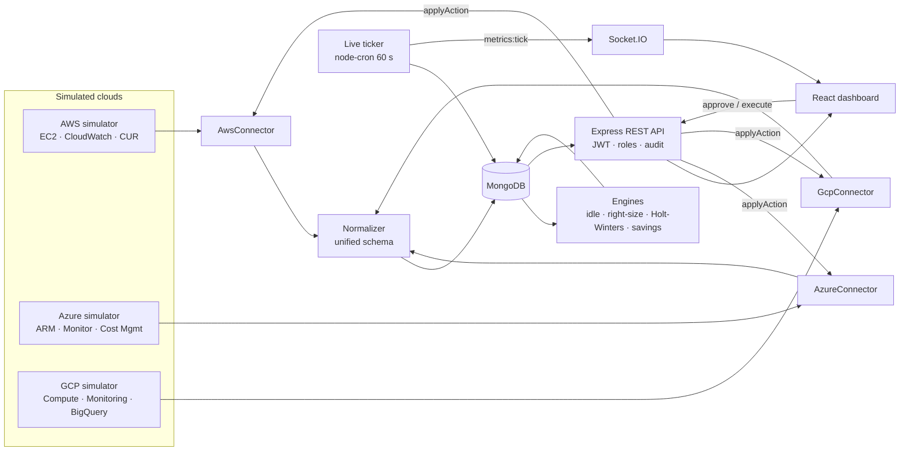

# CloudOptima — Multi-Cloud Resource Management and Optimization Platform

CloudOptima is a single web control panel that shows resources and costs from **AWS, Microsoft Azure and Google Cloud** in one place. It finds wasted money (idle, oversized and orphaned resources), forecasts demand with Holt-Winters exponential smoothing, and lets an approver accept or reject cost-saving actions and simulate their execution against the cloud.

Phase 1 runs against a **realistic simulation engine** instead of real cloud accounts. Everything else is real: a REST API, a MongoDB database, JWT authentication with roles, and every number on screen is calculated from data in MongoDB.

## Phase 1 features

- **Simulated clouds with native API shapes.** EC2 `Describe*`, CloudWatch datapoints and CUR rows for AWS; ARM resources, Azure Monitor metrics (memory as *available bytes*) and Cost Management column/row results for Azure; Compute Engine `aggregatedList`, Cloud Monitoring time series (CPU as a 0–1 fraction) and BigQuery billing-export rows for GCP.
- **Connector → normalizer → MongoDB pipeline.** One connector interface (`listResources`, `getMetrics`, `getCosts`, `applyAction`) for all three providers, plus a normalization layer that maps every native shape to one unified schema.
- **Workload patterns.** Steady, diurnal (IST business hours), weekly, spiky, growing, idle and oversized, with deterministic noise so back-filled history and live ticks agree.
- **Planted waste** for the engines to find: about 12% idle VMs, about 20% oversized VMs, 15 unattached disks, 8 unused public IPs, 20 snapshots older than 90 days, 5 stopped VMs with disks, and 2 cost spikes.
- **Engines.**
  - Idle detector: p95 CPU over 14 days.
  - Right-sizer: cheapest size in the same family that keeps projected p95 under 70%, using the forecast peak when available.
  - Holt-Winters forecaster: daily and weekly seasons plus a linear-trend fallback, back-tested on a 7-day hold-out (MAPE / RMSE), with a 14-day forecast and a 95% band.
  - Savings calculator: potential vs. realized savings.
- **Approval workflow.** Approve, reject with a note, bulk-approve low-risk items, and **simulate execute** (dry run → apply through the connector → verify by re-reading through the normalizer). Every step is written to the audit log.
- **Live simulator.** A new metric point for every running VM each minute, pushed to the dashboard over Socket.IO.
- **Dashboard UI.** Dark and light themes, Ctrl+K command palette, skeleton loaders, animated KPIs, heatmap, forecast bands, and a responsive layout.

## Architecture



The simulated clouds keep their own state in the `sim_cloud_objects` collection. The platform never reads that collection directly: it sees the clouds only through the provider-shaped responses returned by the connectors. Executing a recommendation calls `connector.applyAction()`, which changes the simulated cloud. The platform then re-pulls the inventory through the normalizer, so what you see on screen is what the "cloud" reports.

## Tech stack

| Layer | Technology |
| --- | --- |
| Backend | Node.js 20+, Express, ES modules, Mongoose, JWT + bcryptjs, zod, node-cron, Socket.IO, helmet, express-rate-limit |
| Database | MongoDB Community Server (local) |
| Frontend | React 18 + Vite, Tailwind CSS 3, Framer Motion, Recharts, TanStack Query, axios, cmdk, sonner, lucide-react |

## Prerequisites

- **Node.js 20 or newer**
- **MongoDB Community Server** running on `localhost:27017`. Start it with `net start MongoDB` in an administrator PowerShell, or from MongoDB Compass.

## Setup (Windows PowerShell)

```powershell
npm run install:all
copy server\.env.example server\.env
npm run seed
npm run dev
```

- API: <http://localhost:5000/api/health>
- Dashboard: <http://localhost:5173>. If port 5173 is busy, Vite picks the next free port and prints it in the terminal.

`npm run seed` drops and rebuilds the `cloudoptima` database in about 25–40 seconds and prints a summary table: resources per provider, run-rate, the last 30 days of spend, waste found, and findings per category. Run it again at any time to reset the demo.

### Environment (`server/.env`)

| Variable | Default | Purpose |
| --- | --- | --- |
| `PORT` | `5000` | API port |
| `MONGO_URI` | `mongodb://127.0.0.1:27017/cloudoptima` | Database |
| `JWT_SECRET` | `change_me` | Token signing secret — change it |
| `CLIENT_URL` | `http://localhost:5173` | Allowed CORS origin |
| `SIMULATOR_LIVE` | `true` | Set `false` to stop the 60-second live ticks |
| `USD_TO_INR` | `83.5` | Conversion rate when a user chooses INR |

## Demo logins

| Role | Email | Password | Can do |
| --- | --- | --- | --- |
| Admin | `admin@cloudoptima.io` | `Admin@123` | Everything, including disconnecting accounts |
| Approver | `approver@cloudoptima.io` | `Approver@123` | Approve / reject / execute, sync and connect accounts, run analysis |
| Analyst | `analyst@cloudoptima.io` | `Analyst@123` | View everything; action buttons are disabled with "Approver role required" |

New registrations get the analyst role.

## Project structure

```
server/src
  config/          env + MongoDB connection
  models/          User, CloudAccount, Resource, MetricSample, CostRecord, Forecast, Recommendation, AuditLog
  simulation/      catalog, patterns, world builder, provider simulators, seed, live ticker
  connectors/      BaseConnector + AWS / Azure / GCP connectors (same interface)
  normalization/   provider shape → unified schema
  engines/         idleDetector, rightSizer, forecaster (Holt-Winters), savingsCalculator
  services/        sync pipeline, analysis runner, cost roll-ups, realtime
  controllers/ routes/ middleware/ utils/
client/src
  api/ hooks/ context/        axios + React Query + auth / theme / socket
  components/layout|ui|charts AppShell, sidebar, palette, design system, Recharts wrappers
  pages/                      Overview, Inventory, ResourceDetail, CostExplorer, Forecasts,
                              Recommendations, Accounts, AuditLog, Settings, Login, Register
```

## Main API endpoints (`/api`)

Auth: `POST /auth/register`, `POST /auth/login`, `GET|PATCH /auth/me`.
Accounts: `GET|POST /accounts`, `POST /accounts/:id/sync`, `DELETE /accounts/:id`.
Inventory: `GET /resources` (`provider, region, type, state, tag=env:prod, search, sort, page, limit`), `GET /resources/:id`, `GET /metrics/:resourceId`.
Costs: `GET /costs/summary`, `GET /costs/trend`, `GET /costs/breakdown`.
Forecasts: `GET /forecasts`, `GET /forecasts/:resourceId`, `POST /forecasts/run`.
Recommendations: `GET /recommendations`, `PATCH /recommendations/:id/approve|reject`, `POST /recommendations/bulk-approve`, `POST /recommendations/:id/simulate-execute`.
Other: `POST /analysis/run`, `GET /dashboard/overview`, `GET /audit`, `GET /health`.

Every response has the shape `{ success, message, data }`; paginated lists return `{ items, page, limit, total }`.

## Phase 2 (remaining ~50%)

- Isolation Forest anomaly detection on daily cost and utilization
- Genetic-algorithm workload placement optimizer across providers and regions
- Policy engine with auto-approve rules (e.g. "auto-approve low-risk deletions in dev")
- Savings verification loop: compare billed cost after execution with the predicted saving
- Python ML microservice (ARIMA / Prophet / LSTM) behind the existing `forecastSeries()` interface
- Real AWS, Azure and GCP SDK connectors behind the same connector interface
- PDF / CSV reports
- Email and Slack alerts
